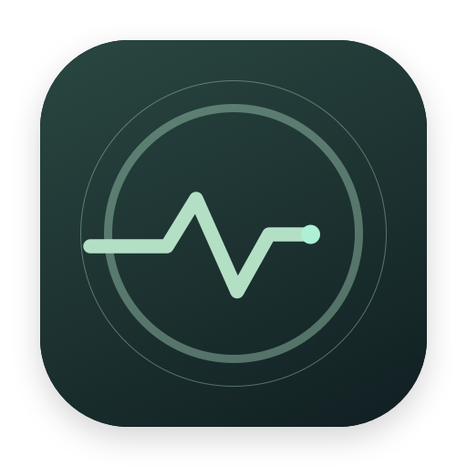
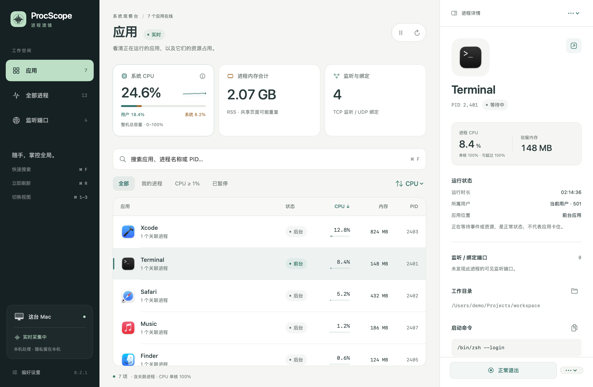
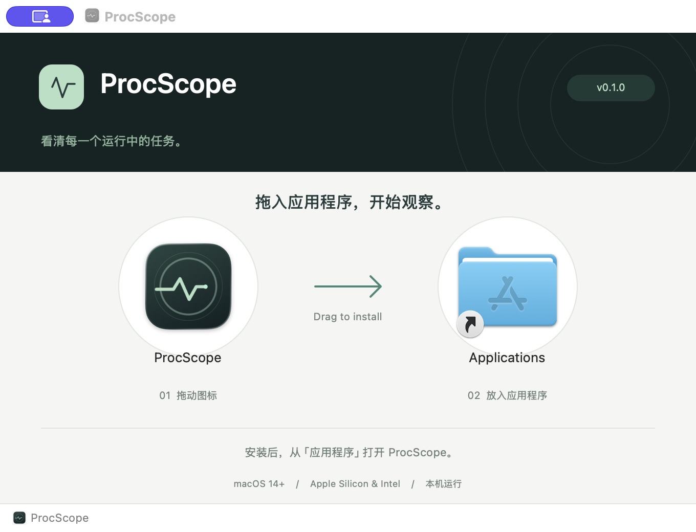

<div align="center">



# ProcScope · 进程透镜

**看清每一个运行中的任务。**

原生 macOS 应用、进程与端口观察工具。找到资源占用的来源，追溯启动命令，确认后再管理。

[](https://github.com/tianguzhe/ProcScope/releases/latest)
[](https://github.com/tianguzhe/ProcScope/actions/workflows/ci.yml)


[**下载最新 DMG**](https://github.com/tianguzhe/ProcScope/releases/latest/download/ProcScope.dmg) · [产品介绍](https://tianguzhe.github.io/procscope/) · [版本记录](https://github.com/tianguzhe/ProcScope/releases)



</div>

## 功能

- **应用**：汇总原生应用及关联辅助进程资源，区分前台、后台、窗口隐藏与暂停；嵌套应用归属到最具体的运行中应用包。
- **全部进程**：展示系统快照，支持名称、PID、路径搜索，以及 CPU、内存、PID、名称排序。
- **监听端口**：查看当前权限可见的 TCP 监听与 UDP 绑定，按端口、应用、进程和协议筛选。
- **端口收藏**：按协议和端口收藏、命名、置顶与筛选；服务停止或 PID 改变后保留收藏。右键复制端口 / 绑定地址，或选择 HTTP / HTTPS 打开 TCP 服务。
- **操作反馈**：显示身份核对、等待结果与最终状态；端口操作执行前重新扫描归属，退出后复查可见端口占用。
- **追溯来源**：可执行文件、启动命令、工作目录、父进程链、直接子进程和端口。
- **管理操作**：正常退出应用、结束、强制结束、暂停和恢复进程；每次操作先确认，再验证进程身份。
- **原生体验**：深浅色适配、柔和动效、系统“减少动态效果”支持；菜单栏快捷入口可在设置中开启。
- **轻量更新**：按字段刷新界面，缓存索引与聚合，详情查询合并、串行执行与短期缓存；启动命令与工作目录直接通过系统接口读取，无需启动子进程；后台采集降频。
- **本机处理**：无账号、无网络上传、无第三方运行依赖，无需安装 witr。

快捷键：`⌘F` 搜索，`⌘R` 刷新，`⌘1/2/3` 切换视图，`⌘0` 打开主窗口。

## 安装

1. 下载 [`ProcScope.dmg`](https://github.com/tianguzhe/ProcScope/releases/latest/download/ProcScope.dmg)。
2. 打开磁盘镜像，将 **ProcScope** 拖入 **Applications / 应用程序**。
3. 从应用程序文件夹打开。更新时先退出旧版，再替换应用。



支持 macOS 14+，一个安装包同时包含 Apple Silicon 与 Intel。发布包采用 ad-hoc 签名，尚未进行 Apple Developer ID 签名与公证。首次打开如被 macOS 拦截，请在「系统设置 → 隐私与安全性」中允许打开。

每个 Release 同时提供 `ProcScope.dmg.sha256`。将两个文件下载到同一目录后校验：

```sh
shasum -a 256 -c ProcScope.dmg.sha256
```

## 状态与边界

- 等待事件和后台运行是正常状态，不表示应用卡住；当前不检测窗口是否无响应。
- 顶部「系统 CPU」由系统累计时间的两次采样差值计算，展示所有核心的总体忙碌比例，范围 0–100%，并区分用户与系统使用。首次采样、长时间暂停后或读取失败时显示明确占位状态。
- 列表和详情的进程 CPU 仍采用 `ps` 口径，单核为 100%，多核合计可超过 100%；不能直接与顶部整机百分比相加比较。RSS 可能重复统计共享页面，不等于整机实际已用内存。
- 列表的应用指标包含关联进程；详情指标对应当前所选 PID。
- 其他用户或受保护进程的目录、端口等信息可能不可见。基本功能不要求辅助功能、屏幕录制或完全磁盘访问权限。
- 只管理当前用户进程；PID 0/1、其他用户和 ProcScope 自身为只读。操作前核对 PID 与启动时间，只对所选 PID 发信号，不递归结束子进程。
- 强制结束可能丢失未保存内容；暂停保留内存与端口；受管理的服务可能自动重启。
- 父进程链来自当前快照，不能还原进程退出后的完整历史。
- 前台约每 3 秒采集进程，后台约 9 秒；端口周期扫描间隔至少 6 秒，实际随循环及命令耗时变化。手动刷新发起完整采集并更新当前详情；扫描期间的新请求合并为后续一次刷新，不丢弃强制端口扫描。命令超时先发送 SIGTERM，再升级 SIGKILL，并支持取消。
- 端口归属以 PID 和启动时间核对；不能验证身份的端口仍可查看与收藏，但无法执行进程操作。收藏按「协议 + 端口」匹配，可对应多个监听地址；“未发现占用”只代表当前权限可见的扫描结果。
- 进程操作最多等待约 3 秒确认，未确认时保留提示，不自动升级为强制结束。采集命令的超时收尾只作用于 ProcScope 自己启动的命令。
- 应用不启用 App Sandbox，以检查和管理其他进程。

## 构建与测试

需要 macOS、Xcode 16+。已提交 Xcode 项目，日常构建不需要 XcodeGen。

```sh
python3 scripts/build_isolation.py prepare # 首次打开 Xcode 前配置本机隔离目录
bash scripts/test.sh                     # 构建隔离测试 + XCTest，仅对测试创建的子进程执行信号
bash scripts/build.sh                    # 构建、签名并验证 Universal 应用
bash scripts/package-dmg.sh --skip-build # 为刚构建的应用打包
bash scripts/build-release.sh            # 一步构建应用 + DMG + SHA-256
bash scripts/preview.sh                  # 使用示例数据渲染公开界面截图 → docs/
```

安装包：`release/ProcScope.dmg`、`release/ProcScope.dmg.sha256`。中间应用位于 `.build/artifacts.noindex/ProcScope.app`；正式使用请从 DMG 将应用拖入 `/Applications`。构建、测试、预览、打包缓存和日志统一位于 `.build/artifacts.noindex/`。

`PROCSCOPE_OUTPUT_DIR` 可调整安装包输出目录，建议使用绝对路径。`PROCSCOPE_BUILD_DIR` 仍可指定 Release 的 DerivedData，但必须位于本项目 `.build/artifacts.noindex/` 内；默认是其下的 `xcode/release/`，测试使用 `xcode/test/`。

DMG 打包需要 Python 3.10+，脚本自动选择可用解释器，也可通过 `PROCSCOPE_PYTHON` 指定。首次在 `.build/artifacts.noindex/dmg-venv/` 安装锁定的 `dmgbuild`、`ds-store`、`mac-alias`。仅构建时使用，应用运行不依赖 Python。Finder 窗口设置直接写入 `.DS_Store`，不依赖 Finder、AppleScript 或辅助功能权限；背景含 1× / 2× 分辨率。

`--skip-build` 会校验签名、双架构、最低系统版本与版本号；同版本源码发生变化后应重新构建再打包。应用先在临时目录完成校验，再替换旧产物。最终压缩 DMG 会在隔离目录内只读挂载，检查包内应用签名、架构、二进制与版本信息一致性、Applications 链接和 Finder 布局文件，通过后才输出安装包并复核 SHA-256。

修改 `project.yml` 后运行 `xcodegen generate`。版本号统一放在 `Version.xcconfig`，Xcode、打包脚本和发布标签共用。

### 开发副本与应用搜索

`.noindex` 目录用于排除 Spotlight 索引。构建入口和 Xcode 共享 Scheme 在构建、测试、运行或归档结束后，按路径注销本项目开发 App 的 LaunchServices 注册，减少应用搜索中的同名副本。首次打开 Xcode 前运行上面的 `prepare`，它只更新被 Git 忽略的本机 workspace 设置，并保留其他设置；已经打开的 Xcode 需重新打开项目以使用新路径。

```sh
python3 scripts/build_isolation.py status
python3 scripts/build_isolation.py cleanup --dry-run
python3 scripts/build_isolation.py cleanup
```

清理只请求注销注册，不删除应用或重置系统索引。范围包括本项目的构建目录、归属元数据匹配的旧 DerivedData，以及旧脚本生成的 `release/ProcScope.app`（存在时须匹配 bundle ID）；不会清理 `/Applications` 中的安装副本或沿符号链接清理外部应用。旧产物保留在原位，直接启动开发 App 可能重新注册，退出后可再次执行 `cleanup`。系统可能保留 `launch-disabled` 的数据库记录；注销成功不等于记录立即消失，Spotlight 或其他启动器的缓存也可能需重新打开搜索界面才能刷新。

本次流程参考 [MacClean e790488](https://github.com/tianguzhe/MacClean/commit/e7904880af6adf1bb6d9e067a667fb77dd3231fe) 和 [QuietLock d69c43a](https://github.com/tianguzhe/QuietLock/commit/d69c43addcc77aa92a04c8e2310a703f883d52ee) 的构建隔离改动。

## 自动化发布

1. 修改 `Version.xcconfig` 的 `MARKETING_VERSION` 和 `CURRENT_PROJECT_VERSION`。
2. 提交到干净的 `main` 分支。
3. 运行 `bash scripts/release.sh`。

脚本先运行测试，再原子推送 `main` 和 `v<版本>` 标签。GitHub Actions 在 `macos-26` 上检查版本、运行测试、构建 Universal DMG，上传固定名称的安装包与 SHA-256，再将草稿发布为正式 Release。发布下载链接始终为：

```
https://github.com/tianguzhe/ProcScope/releases/latest/download/ProcScope.dmg
```

普通 push / PR 自动测试并验证双架构构建；只有版本标签触发 Release。失败步骤会显示摘要注释，测试诊断和 `.build/artifacts.noindex/logs/` 下的完整步骤日志作为构建附件保留。已发布版本不会在重跑时被覆盖；上传中断的草稿可以继续。

产品落地页位于 [`tianguzhe.github.io`](https://github.com/tianguzhe/tianguzhe.github.io)，推送该站点的 `main` 自动部署。应用版本更新无需改动下载地址。

## 项目结构

- `ProcScope/`：SwiftUI 界面、数据模型和系统服务。
- `ProcScopeTests/`：解析、索引、进程身份保护和受控信号测试。
- `Version.xcconfig`：统一版本配置。
- `Tools/`：DMG 绘图、Finder 布局、固定版本打包依赖、示例截图渲染器。
- `scripts/`：构建、测试、签名校验、打包、截图和发布脚本。
- `.github/workflows/`：持续构建与标签发布。
- `docs/`：图标、使用示例数据的浅深色界面与安装预览。

发布流程借鉴同系列的 [QuietLock](https://github.com/tianguzhe/QuietLock)。性能与实机验证记录见 [VALIDATION.md](VALIDATION.md)，视觉规范见 [DESIGN.md](DESIGN.md)。
